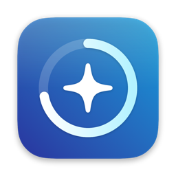
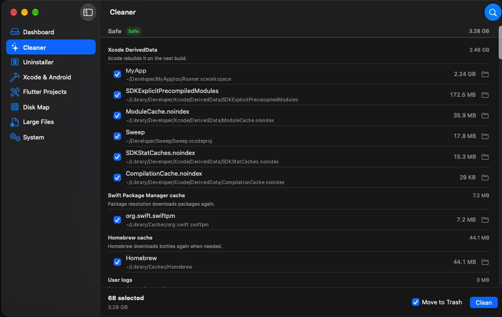
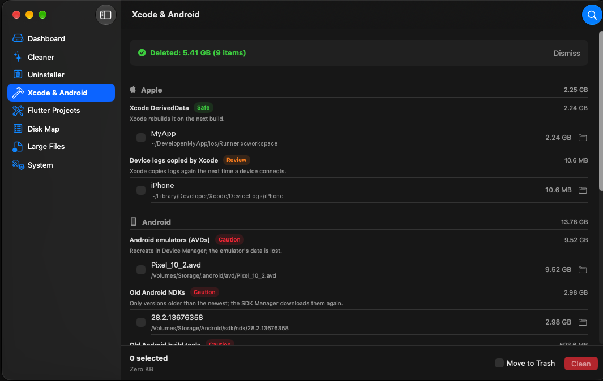
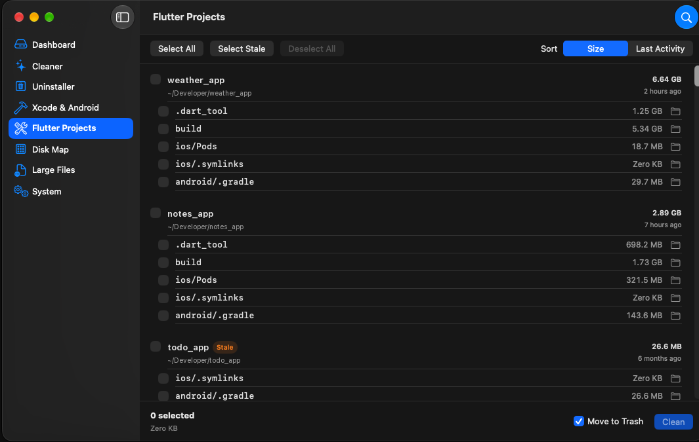
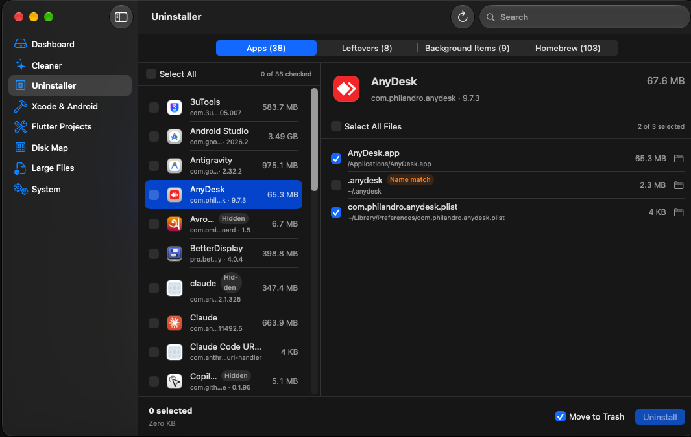
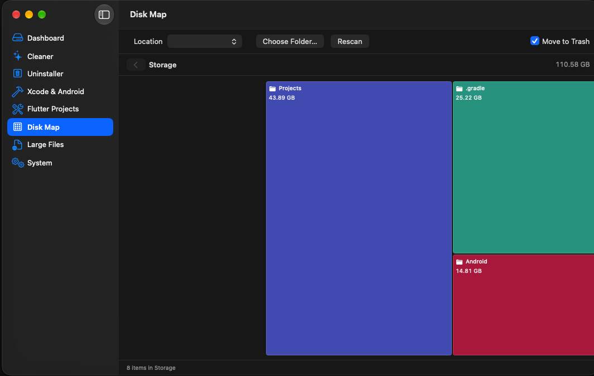
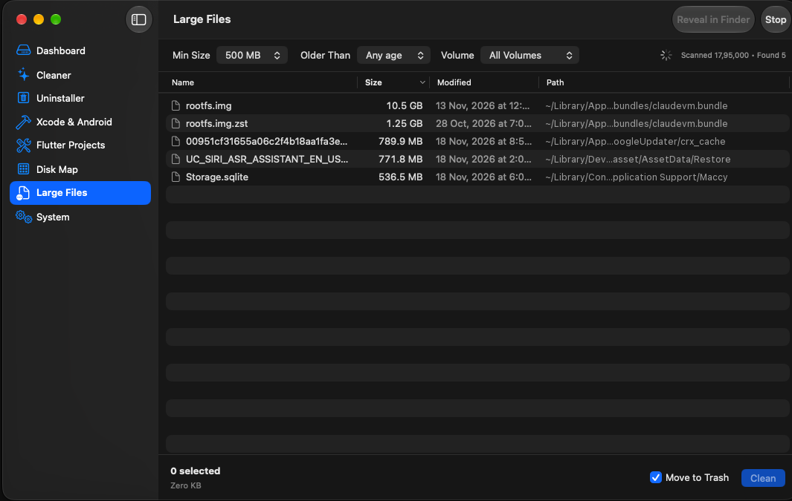

<p align="center">
  
</p>

<h1 align="center">DevDustpan</h1>

<p align="center">
  A native macOS cleaner built for software developers.<br>
  It finds the gigabytes that Xcode, Android Studio, Flutter, Gradle, CocoaPods and npm leave behind, and removes them safely.
</p>

<p align="center">
  <a href="https://github.com/Appentium/DevDustpan/releases/latest"><b>Download the latest release</b></a>
</p>

<p align="center">
  
</p>

---

The app installs as **Sweep**. It is a SwiftUI app with a small privileged helper and a `sweep` command-line tool.

## Why

General Mac cleaners skip most developer data or treat it as a black box. A developer's disk fills up with build output and caches that can all be regenerated: DerivedData, simulators, Gradle caches, Android system images, `build/` folders in every Flutter project. Sweep knows what each of these is, what rebuilds it, and how risky it is to remove.

## Features

- **Cleaner**: 40+ built-in rules for caches, logs and build output. Each rule says what it is, what regenerates it, and a tier:
  - **Safe**: rebuilt automatically (DerivedData, SwiftPM, Homebrew, CocoaPods, npm, Yarn and pip caches, Gradle build cache).
  - **Review**: re-downloaded on demand (old Gradle caches and wrappers, old iOS DeviceSupport, the Dart pub cache, unused Docker data).
  - **Caution**: you pick each item (AVDs, unused Android system images, old NDKs, build tools and SDK platforms, simulator runtimes, Xcode archives, device backups).
- **Xcode & Android**: everything for both platforms in one place. DerivedData folders are labelled with the project they belong to, and simulators and runtimes are removed through `simctl`.
- **Flutter Projects**: finds every Flutter project on every mounted volume and lists the `build/`, `.dart_tool/`, `ios/Pods` and Gradle folders, with last activity, per-project select-all and *Select stale*.
- **Project artifacts**: `node_modules`, `Pods`, Gradle `build/` and Cargo `target/` are removed only when the matching marker file (`package.json`, `Podfile`, `build.gradle`, `Cargo.toml`) sits next to them, and never in projects you touched recently.
- **Uninstaller**: removes apps together with their leftovers, background items and Homebrew packages. It also finds leftovers of apps that are already gone.
- **Disk Map**: a treemap of any folder or volume with drill-down.
- **Large Files**: finds large and old files with size and age filters.
- **System**: local Time Machine snapshots, `/Library/Caches`, rotated system logs and root-owned trash, through a privileged helper with a fixed allowlist.
- **External disks**: scans every mounted volume and shows each volume's trash, with an Empty Trash button.
- **Automation (all off by default)**: a menu bar item, low-space alerts and a scheduled clean of the Safe tier.

## Screenshots

| Xcode & Android | Flutter Projects |
|---|---|
|  |  |
| **Uninstaller** | **Disk Map** |
|  |  |
| **Large Files** | |
|  | |

## Safety

- You always see a preview before anything is removed. **Move to Trash** is on by default; untick it for an instant delete.
- A hard deny list refuses Keychains, iCloud Drive, the Photos, Messages and Mail libraries, `/System`, volume roots and your home folder, even if a rule or the UI asks for them.
- Items that belong to a running app, or caches in use by a running tool (for example a Gradle daemon), are skipped.
- Every removal is logged to `~/Library/Logs/Sweep/clean.log`.

## Install

1. Download `Sweep.zip` from the [latest release](https://github.com/Appentium/DevDustpan/releases/latest), unzip it, and move **Sweep.app** to `/Applications`.
2. Open it and grant **Full Disk Access** when asked, so it can measure caches in protected folders.
3. Optional: to use the **System** section, allow Sweep's helper under **System Settings → General → Login Items & Extensions**.

Requires macOS 27 or later on Apple silicon. The app is signed with a Developer ID and notarized by Apple.

### Command line

The `sweep` tool ships inside the app:

```bash
/Applications/Sweep.app/Contents/MacOS/sweep scan
```

| Command | What it does |
|---|---|
| `sweep scan` | Lists reclaimable items grouped by rule. Read-only. |
| `sweep clean` | Cleans the Safe tier. Moves to Trash unless `--delete` is given. |
| `sweep system …` | Root-level cleanup through the helper: `status`, `install`, `uninstall`, `snapshots`, `caches`, `logs`, `trash`. Each lists first; `--clean` removes. |

## Build from source

Requires Xcode 27 and [XcodeGen](https://github.com/yonaskolb/XcodeGen).

```bash
brew install xcodegen
```

```bash
make gen build
```

```bash
make test
```

All scanning and cleaning logic lives in the `SweepCore` Swift package (`Packages/SweepCore`), with tests that run against temporary folders only. The SwiftUI app is in `App/`, the helper in `Helper/` and the CLI in `CLI/`. To sign with your own team, change `DEVELOPMENT_TEAM` in `project.yml`.
